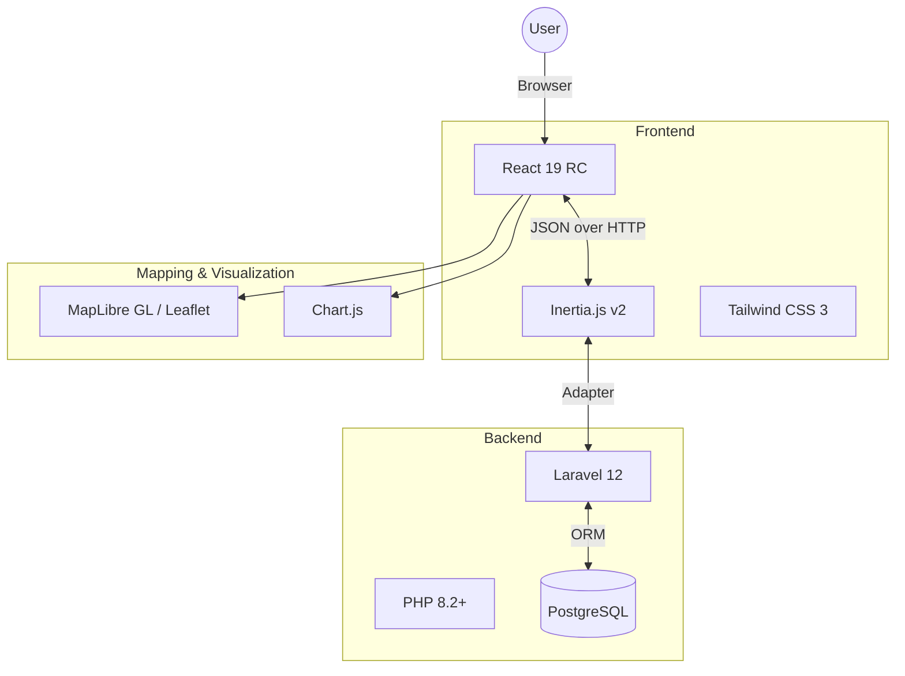
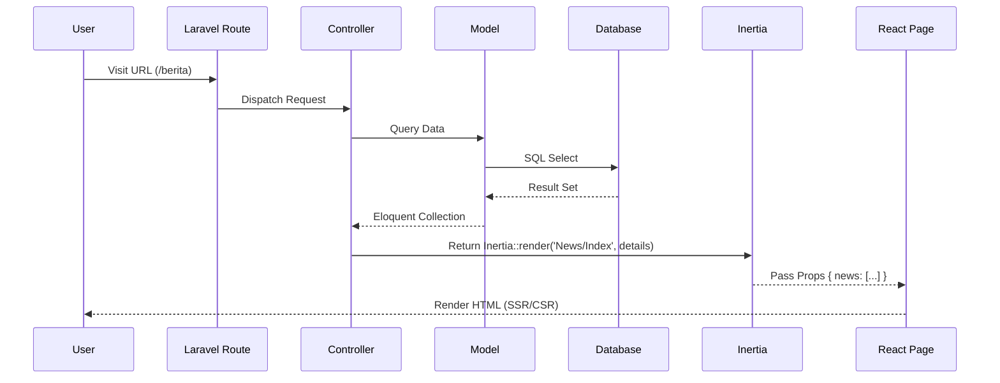
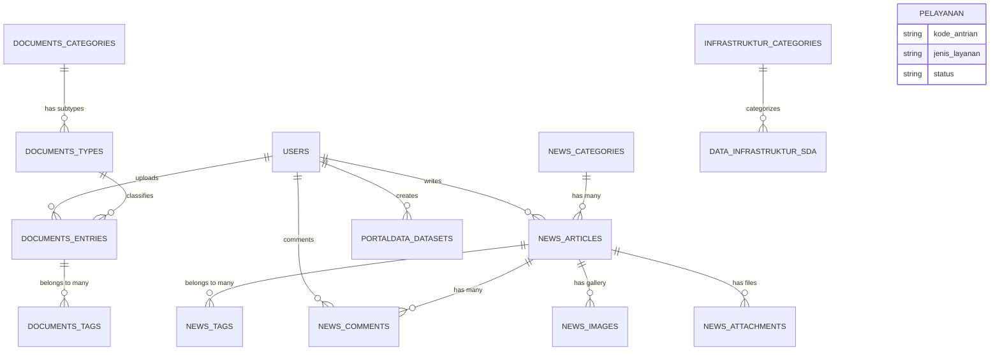

# Arsitektur Proyek PUSDA Jatim SISDA

Dokumen ini menjelaskan arsitektur teknis dari **Sistem Informasi Sumber Daya Air (SISDA)** Dinas PU SDA Provinsi Jawa Timur.

## 1. Tech Stack Overview

Proyek ini dibangun menggunakan stack **Modern Monolith** dengan Laravel dan React dalam satu repositori (Monorepo), dihubungkan oleh Inertia.js.

## 2. Alur Data (Data Flow)

Aplikasi menggunakan pola **Model-View-Controller (MVC)** klasik, namun View-nya digantikan oleh React component via Inertia.js. Tidak ada REST API terpisah (kecuali untuk hal spesifik), komunikasi frontend-backend terjadi "seamlessly" seperti aplikasi MPA klasik namun dengan pengalaman SPA.

## 3. Pola Rendering (SSR vs CSR)

Proyek ini menggunakan strategi **Hybrid Rendering**:

| Tipe Halaman     | Rendering                   | Lokasi File                  | Alasan                                                                              |
| ---------------- | --------------------------- | ---------------------------- | ----------------------------------------------------------------------------------- |
| **Public Pages** | Server-Side Rendering (SSR) | `resources/js/Public/Pages/` | Dibutuhkan untuk **SEO** (Search Engine Optimization) agar konten terindeks Google. |
| **Admin Pages**  | Client-Side Rendering (CSR) | `resources/js/Admin/Pages/`  | Fokus pada interaktivitas tinggi dan performa aplikasi SPA. Tidak butuh SEO.        |

Konfigurasi ini diatur di `resources/js/app.jsx` dan `resources/js/ssr.jsx`.

## 4. Struktur Modul & Domain

| Modul                 | Deskripsi                                       | Controller Utama                                                            | Frontend Path        | Tabel Database Utama                        |
| --------------------- | ----------------------------------------------- | --------------------------------------------------------------------------- | -------------------- | ------------------------------------------- |
| **Berita (News)**     | Manajemen artikel, kategori, tag, komentar      | `Admin/NewsController`   `Public/NewsController`                         | `News/*`             | `news_articles`, `news_categories`          |
| **Dokumen**           | Repositori dokumen regulasi & laporan           | `Admin/DocumentController`   `Public/DocumentController`                 | `Documents/*`        | `documents_entries`, `documents_categories` |
| **Pelayanan**         | Antrian layanan publik (FHD, SIH3, JOSS)        | `Admin/PelayananController`   `Public/PelayananController`               | `Pelayanan/*`        | `pelayanans`                                |
| **Infrastruktur SDA** | Data spasial infrastruktur (Pintu air, Bendung) | `Admin/InfrastrukturSDAController`   `Public/InfrastrukturSDAController` | `InfrastrukturSDA/*` | `data_infrastruktur_sda`                    |
| **Portal Data**       | Dataset terbuka untuk publik                    | `Admin/PortalDataController`   `Public/PortalDataController`             | `PortalData/*`       | `portaldata_datasets`                       |
| **SDA Dalam Angka**   | Statistik tahunan SDA                           | —                                                                           | `SDADalamAngka/*`    | — (JSON Driven)                             |
| **User & Role**       | Manajemen akses pengguna                        | `Admin/UserController`   `Admin/RoleController`                          | `Users/*`, `Roles/*` | `users`, `roles`, `permissions`             |

## 5. Glossary Istilah Domain

- **SDA**: Sumber Daya Air
- **FHD**: Forecasting, Hydrologi, Data — layanan peramalan banjir dan data hidrologi.
- **SIH3**: Sistem Informasi Hidrologi, Hidrometeorologi, dan Hidrogeologi.
- **JOSS**: Jaringan Observasi Sumber daya air Strategis — layanan data observasi khusus.
- **WS**: Wilayah Sungai (unit pengelolaan sungai, misal: WS Brantas, WS Bengawan Solo).
- **UPT**: Unit Pelaksana Teknis — kantor cabang dinas di kabupaten/kota.
- **Bina Manfaat**: Bidang yang mengurusi pemanfaatan sumber daya air.
- **Irigasi**: Bidang yang mengurusi jaringan irigasi pertanian.

## 6. Entity Relationship Diagram (ERD)

Berikut adalah gambaran relasi database utama:

