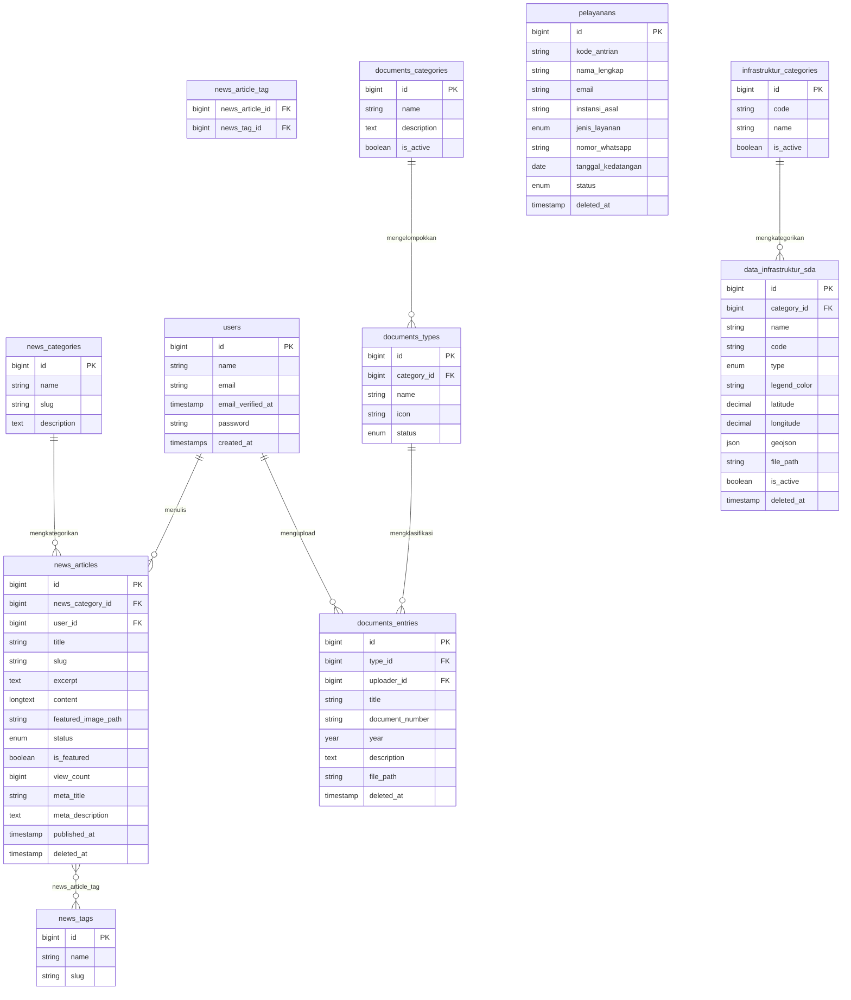

# ERD — SISDA (Selected Tables)

Tabel yang disertakan: `users`, modul news, modul documents, `pelayanans`, infrastruktur SDA.
Tabel yang dilewati: `news_images`, `news_attachments`, `news_comments`, `documents_tags`, pivot tables, cache, jobs, sessions, permission tables.

